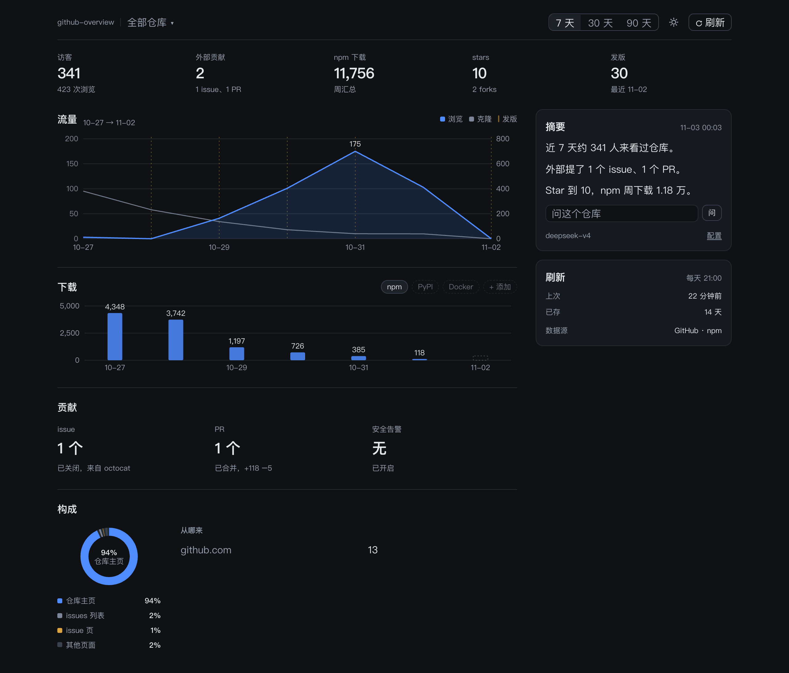

# github-overview

自己的 GitHub 仓库，一个页面看完：浏览与克隆的趋势、npm 等外部来源的下载、流量落在哪些页面、外部人提了多少 issue 和 PR，右边一段 AI 写的摘要。

不依赖第三方统计服务，只跑一个本地 Node 进程：读你自己的 token，把数据抓下来存到本地，页面在浏览器里打开。



## 用法

```bash
npx github-overview init --user 你的GitHub用户名   # 绑定账号下全部仓库
npx github-overview init --repo owner/repo --npm 包名
npx github-overview start      # http://127.0.0.1:4317
```

- `--user` 会把账号下自己拥有的仓库都绑上；页面顶部可以切到「全部仓库」看合计，也可以切单个仓库。只要一部分就写 `--repo a/b,c/d`。
- `--npm` 按同一个顺序对应仓库，只在包名和仓库名不一样时才写。默认拿仓库名去找包，找到了还要核对 registry 上的维护者是不是你，不是就不算下载。
- 首次同步把 14 天内的流量存到本地，之后每 6 小时自动刷新（`--refresh` 可改），页面上的「刷新」随时手动同步。
- AI 摘要：`npx github-overview config --apikey KEY --baseurl URL --model MODEL`，或点页面右下角「配置」直接填，只存本机 `~/.config/github-overview/config.json`。模型不写用 `deepseek-chat`。
- 没配 AI 也能用，摘要走内置模板；配好后还能在摘要框下面问一句，按当前范围的数据回答。

## 为什么需要它

GitHub 自带的 traffic 只给 14 天，而且只有浏览和克隆，看不到 npm 下载。页面下半有一块「发版效果」：挑最近一个前后都有数据的版本，把发版前后 7 天的浏览与下载日均并排放在一起，涨没涨一眼能看出。发行版一多、渠道一散，判断「这次发版有没有人真用上」就得自己拼数据。这个项目把 GitHub traffic、npm 下载、发版记录放在同一条时间轴上，再用一句话说清发生了什么。

## 口径

| 名字 | 含义 |
| --- | --- |
| 浏览 | 打开页面的总次数 |
| 访客 | 去重后的人数，一个人来三次算一个 |
| 克隆 | `git clone` 的总次数 |
| 克隆人数 | 去重后的人数 |
| 发版 | 窗口内发布的版本，含 npm 发布时间 |
| 外部贡献 | 别人提的 issue 和 PR，作者自己和 CI、机器人账号的不计 |

- 浏览和克隆是两个指标，不相加。
- 页面构成是浏览落在哪些页面，来源是从哪个站进来，两者分开。
- 预估真实用户只取访客人数，克隆数不参与人数估算。
- 多仓合计时浏览、克隆、下载、star 相加；访客不去重跨仓相加，沿用的是各仓 API 给的人数。

## 数据源

| 来源 | 指标 | 粒度 |
| --- | --- | --- |
| GitHub traffic | 浏览、克隆、页面、来源 | 每日 + 快照 |
| GitHub search | 外部 issue、PR | 按创建时间 |
| GitHub alerts | 安全告警 | 快照 |
| npm | 每日下载、版本时间 | 每日（约 2–3 天延迟） |

首个版本做 GitHub + npm，其余来源按同一接口追加。

## 14 天窗口

GitHub 的 traffic 只保留最近 14 天，所以第一次运行就要开始存快照。30 天、90 天视图读本地存储，只画有记录的那段，不会把空缺画成 0。

访客是 14 天窗口内去重的人数，GitHub 不提供更长范围的人数，所以 30 天、90 天视图显示同一个值，并在访客下面标出「覆盖 N 天」，不会因为切了范围就变少。

## 路线

- [x] 页面与视觉规范
- [x] 本地存储与 GitHub / npm 抓取
- [x] 定时刷新与手动刷新
- [x] 面板内配置（AI 的 base URL 与 key）
- [x] AI 摘要，未配置时用模板
- [x] 摘要框里直接提问
- [x] npm 包归属核对，机器人 PR 不计入外部
- [x] 绑定 GitHub 账号，多仓切换与合计
- [x] 提问会自己查数据：跨仓比较、拉最新、给估算

## License

MIT
